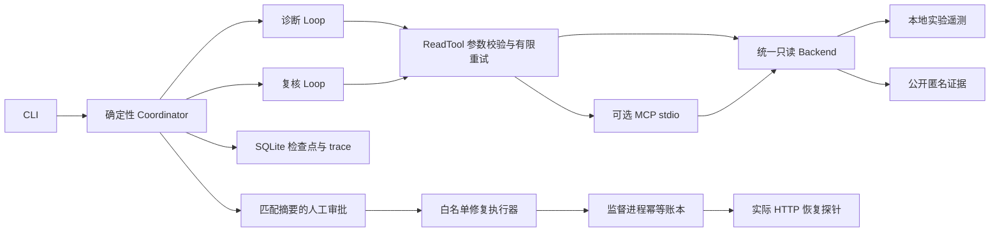
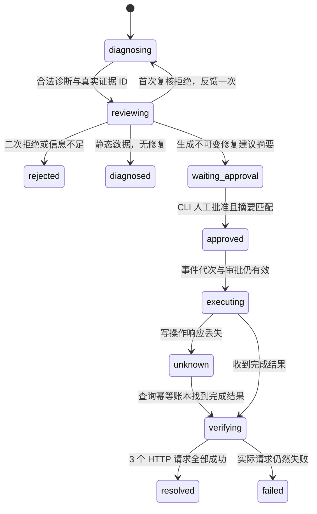

# 架构、状态与故障语义

本文描述一次调查和修复的核心状态机。持续会话、调度及 Linux Umami 适配见 [RUNTIME.md](RUNTIME.md)。

## 组件边界

LLM 负责提出有证据的诊断。调度器负责 schema、状态、权限、预算和执行。Agent 不持有 shell、通用文件系统或审批工具；无法通过生成命令执行主机代码。本地多进程用于故障复现，不声称是执行不可信代码的安全沙箱。

## 状态机

SQLite 保存阶段、证据、最终诊断、复核、修复摘要和审批。`resume` 在新的 CLI 进程中重建 Coordinator。诊断中断会重新进行有界的只读调查，不声称精确恢复模型内部推理。修复阶段使用同一操作 ID 查询监督进程的已完成结果。

运行租约防止两个 CLI 同时恢复同一会话；非正常退出后通过过期租约恢复。它不是分布式领导者选举，也不支持多机共享 SQLite。

## 写入超时与幂等

1. 修复建议摘要覆盖运行 ID、事件代次、目标服务、动作和诊断摘要。
2. 人工审批持久化上述摘要及 10 分钟到期时间。
3. 执行时复查摘要、当前诊断、服务及事件代次，防止旧审批执行新动作。
4. 修复操作 ID 为 `repair-<run_id>`；监督进程对同 ID 不同参数拒绝，同 ID 已完成请求返回记录。
5. 丢失响应时，调用方进入 `unknown`，不自动再次写入；恢复时先查询操作记录。
6. 本地动作采用幂等的期望状态语义：仅启动已停止的自有进程、把延迟恢复为零、停止自有锁持有者。

这不提供任意远程服务的 exactly-once 保证。若监督进程在副作用发生与记录提交之间崩溃，通用外部动作仍需要后端幂等能力和对账。本地白名单的期望状态语义限制了重复执行的影响。监督进程自身的跨重启接管不是本版功能。

## 超时与重试

- 调查 HTTP 有 I/O 超时；只读工具最多 3 次尝试，非重试错误如权限拒绝不重试。
- MCP 初始化、调用和关闭各有等待上限；stdio 生命周期由 async context manager 管理。
- 模型有请求超时、阶段 deadline 检查与步数上限。deadline 在调用边界检查，不通过强杀 Python 线程假装取消远端请求。
- 复核最多导致一次返工；第二次拒绝后停止，不无限套娃。
- 模型适配器直接发出一次 HTTP 请求，避免框架和 SDK 叠加重试。失败且计费未知的请求保留费用预留。

## 上下文隔离

复核阶段创建新的 Loop 和模型会话，接收结构化诊断。复核通过 `get_evidence` 实际取回引用证据，确定性校验拒绝未取回的证据 ID。Loop 的模型、工具与 schema 来自 smolagents。

两者使用同一模型时仍可能存在相关错误；隔离上下文不等于独立专家。评测必须报告复核是否增加质量或只是增加耗时/成本。

## Schema 恢复的真实问题

开发期真实模型曾返回 13 条引用，违反 `evidence_ids <= 12`，造成会话失败。当前 Loop 将校验错误放进对应工具结果，让模型在原步数预算内修正。回归测试分别注入过多引用和伪造引用 ID，要求得到合法结论且 trace 保留 `output_rejected`。

## 数据与密钥

本机 `.env` 配置不进入 Git。API key 只放 Authorization 头，不进入提示词、模型 trace 或 HTML。测试通过假 key 检查这一边界。实验子进程移除继承环境中的 API key、密码和常见令牌变量。

公开数据的原始带根因目录和评分答案只供导入/评分器使用；Agent 接收匿名 ID 和固定公式转换的证据。提示词提醒遥测为不可信数据，执行权限则由实际工具集合限制，不依赖模型自律。HTML 报告对所有不可信内容转义。
