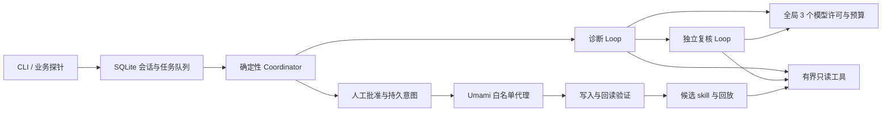

# 持续运维架构与验收记录

本项目实现 Python Agent Loop，保留 smolagents 的 Model、Tool 和工具 schema。设计思想参考公开教学项目的工具循环和上下文压缩章节。[learn-claude-code](https://github.com/shareAI-lab/learn-claude-code)

Loop 保存每一组工具调用和匹配结果，校验拒绝后继续迭代，触及步数或时限即停止。上下文保留结构化约束、最近两轮和按关键词选择的历史摘要。原始消息与证据在 SQLite 留存，`get_prior_turn` 仅能读取同一会话的既往轮次。复核单独取回诊断引用的本轮证据。

运行中 worker 通过本机文件锁独占调度状态，SQLite 事务保存运行、任务、审批和探针样本。重启会重新排队未完成的只读任务，撤销未执行的审批，对未知写入只查询代理账本。本机进程在模型请求期间崩溃时，模型许可设置保守的等待期，供应商端取消情况仍需由供应商提供证据。

Umami 代理通过 Unix socket 接收固定 schema。Agent 服务运行于非特权账号。代理校验最新运行、审批摘要、守护进程代次、前置状态和配置哈希，只能重启 Umami 或恢复管理范围内的端口配置。数据库观测只输出分类后的信号，业务验证通过 Umami 写入事件、再通过只读 SQL 查询对应行。

已验证的修复可自动生成 skill 候选。在线模式调用配置的模型，离线模式使用模板。静态回放用正例和反例检验适用条件，审批绑定候选和回放哈希，后续版本需重新回放审批。此回放覆盖经验匹配；在隔离应用上验证修复效果仍需对应的真实故障实验。

2026-11-19 的本机回归与模型实测结果如下。

| 项目 | 结果 |
|---|---|
| 工程回归评测 | 45 次，12 个 RCAEval 历史组、3 类实际本地故障、3 种变体 |
| 有界重试的修复结果 | 单角色和双角色各 3/3。合计 6 次写入响应丢失均完成对账，重复修复事件 0 |
| HTTP 模型替身 | 10 个并发会话，30 次 HTTP 请求，服务端峰值在途 3，请求与结果 ID 全部配对 |
| DeepSeek Flash | 10 个 RCAEval 回归会话，74 次模型请求，客户端峰值在途 3，8/10 正确且完成验证，耗时 32.422 秒 |
| DeepSeek Flash 修复 | 3 类本地真实故障，单角色和双角色各 3/3 完成修复。6 次丢响应均对账成功，重复修复事件 0 |
| DeepSeek Flash skill | 生成 1 个进程退出候选。1 个正例和 1 个相似反例通过静态回放，候选等待人审 |
| 模型费用 | 并发评测 0.563512 元，修复评测 0.217796 元，均按配置单价估算 |

DeepSeek 测试采用单 Agent，2 个案例耗尽 8 步，保留为失败。10 个案例来自之前的 RCAEval 组。该历史并发成绩与后续 0.2.1 串行回归分开报告。

## 云端实际业务验收

环境为 Ubuntu 24.04、2 核 4 GiB，Umami 3.5.0 + PostgreSQL 15.20。业务流量为合成请求；观察期使用 0.2.0 和离线诊断模型。付费模型评测在本机独立运行，不能称作 72 小时持续在线模型排障。

| 验收项 | 实测结果与范围 |
|---|---|
| 短窗口业务压力 | 1/3/5/10 RPS 各 15 秒；285/285 请求被接受并逐批回读，丢弃 0。10 RPS 的 p95 为 48.37 ms。这是短窗口负载，不是容量上限或长期吞吐承诺 |
| 数据库不可达与无响应 | 两个故障均定位到 PostgreSQL，建议升级人工，动作 `none`；未对数据库执行修复 |
| 应用进程停止 | 审批后重启指定 Umami，动作账本 1 条完成记录，3 次业务验证通过 |
| 应用配置漂移 | 审批后回滚受管端口配置，3 次业务验证通过，数据库容器保持同一实例 |
| Worker 崩溃矩阵 | 只读任务恢复、旧审批失效、未知且无账本记录的写入暂停、已提交丢响应的动作对账；重复修复 0 |
| Umami 统计 API | 初次无凭据为 401；临时只读访问下独立路径 pageviews 0→1，首次读可见耗时 40 ms；凭据撤销后端点 404 |

## 72 小时连续性审计（2026-11-23）

固定截止窗口约 100.915 小时，共 6,080 个样本：6,053 次健康、27 次不健康。失败均处在保留的受控故障演练区间，未从分母剔除。4 个告警全部关闭；最大相邻采样间隔 63.177 秒，低于验收上限 150 秒。最后一个失败样本之后连续健康约 100.274 小时，超过 72 小时要求。

该结论证明每分钟采样链路的连续性和观察到的业务健康；采样无法证明两次采集之间绝无短暂异常，健康样本比例也不等于生产 SLA。原始导出由三个独立校验的压缩分页重建，公开归档保留缩减字段时间线和源审计 SHA-256，不公开主机地址。

## 上下文与 skill 消融

| 上下文策略 | 正确取回历史证据 | 平均初始字节 | 平均总输入 token（含工具取证） |
|---|---:|---:|---:|
| 全历史 | 4/4 | 10,846 | 2,047 |
| 简单截断 | 0/4 | 1,911 | 687 |
| 分层与按需取回 | 4/4 | 2,621 | 2,438 |

三组均保留独立结构化权限约束，约束题均为 4/4。分层减少首轮输入约 75.8%，但这些题都需要取回早期证据，实际总输入 token 比全历史高，不能声称降低总成本。

关闭 skill、人工手册和生成 skill 三组各完成 3/3 次实验修复；平均模型调用依次为 6.67、6.00、7.00。生成 skill 在一个正例命中，两个反例未误命中。候选在独立状态库完成回放、审批启用、检索、停用。案例仍来自同一故障族，本轮未证明泛化或修复率提升。

归档入口：[本轮协议、完整 trace 与验收结果](../artifacts/evaluation/2026-11-23/README.md)。

## 0.2.1 部署后验证（2026-11-23）

四组远程 CI（Windows/Linux × Python 3.12/3.13）通过后，云端从提交 `371902eb0730f9ad0e41971ef640cada25d61698` 升级到 0.2.1。升级前创建 SQLite 一致性备份；历史会话、运行和探针记录保留。三个业务验证请求均为 HTTP 200，耗时 332/368/310 ms。worker、动作代理与探针定时器均 active。

同一新会话的两轮只读调查均正常完成。健康现场没有可支持的故障根因，离线诊断返回 unknown，系统安全停在 `rejected`，动作 `none`；这个状态不计为模型诊断正确率，也没有触发修复。运行记录从 6 条增至 8 条，历史记录未丢失。

观察期版本仍是 0.2.0；本次升级的冒烟检查单独归档，不能把前述 100 小时算作 0.2.1 的运行时长。见[部署原始输出与哈希](../artifacts/deployment/2026-11-23/README.md)。
